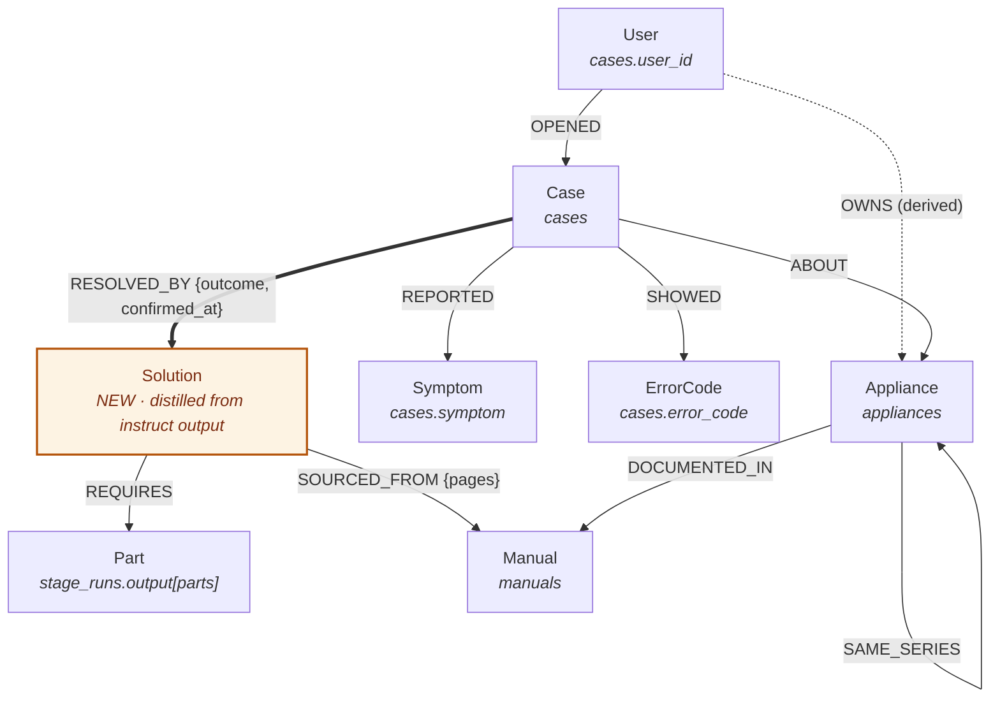
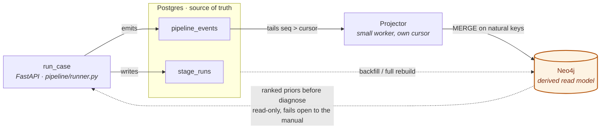

# Proposal: A Repair Knowledge Graph for Opera AI

**Status:** idea, not started. Estimated first version: 2 to 3 weeks for one engineer.

## The problem

Every case today is an island. We store the case, the photos, and each pipeline
stage's output in Postgres, but nothing connects case 400 to the 39 earlier
cases on the same furnace with the same status code. The diagnose stage
re-derives its answer from the manual every time, at full Gemini Pro cost, and
we never learn whether the repair actually worked.

We also have no memory of the user. `cases.user_id` exists but is never
populated, so a returning customer is a stranger.

## The proposal

Build a knowledge graph in Neo4j that links users, appliances, symptoms, error
codes, and the solutions that resolved them. Postgres stays the source of
truth. The graph is a derived read model that can be rebuilt from Postgres at
any time, so it adds no data-loss risk.

Two things it gives us:

1. **Better and cheaper diagnoses.** Before the diagnose call, look up what
   fixed the same symptom on the same model or its series siblings, and hand
   those as ranked hypotheses to the model. The manual stays the authority;
   the graph changes the order in which hypotheses are checked.
2. **User memory.** "You had an ignition lockout on this furnace in March and
   replacing the flame sensor fixed it." Repeat-issue detection, warranty
   context, and a reason to come back.

## The model

Eight node types, edges named as verbs. Each node's subtitle names where it
comes from in Postgres today. Only `Solution` is new.



`Appliance`, `Case`, and `Manual` mirror tables we already have. `Solution` is
new: a distilled version of the instruct stage's output, deduplicated so the
same fix across many cases is one node with many edges into it. That is what
lets us rank fixes by how often they worked.

| Node | MERGE key | Notes |
|---|---|---|
| User | `user_id` | Column exists, never populated. Needs per-user auth first. |
| Case | `case_id` | Projected when the case reaches `ready`. |
| Appliance | `(brand, model_normalized)` | Same unique constraint as the Postgres table. `SAME_SERIES` comes from the `series` column. |
| Manual | `manual_id` | One node per ingested PDF. |
| Symptom | `text_normalized` | Lowercased and stemmed. Coarse on purpose so cases cluster. |
| ErrorCode | `(brand, code)` | Reuses the regex the retrieval stage already runs. |
| Part | `part_number`, else `(brand, name)` | Only numbers the manual printed. Same rule as today. |
| Solution | vector match above threshold, else new id | Embedded summary in Neo4j's vector index. Inherits `safety_tier` from the gate. |

Each `Solution` inherits the safety verdict from the existing gate, so a
technician-only repair is never surfaced as a DIY suggestion.

## How it gets populated



The pipeline never writes to Neo4j directly. `pipeline_events` is the outbox,
the projector is a consumer, and every write is a MERGE, so at-least-once
delivery and full replays are the same operation.

- **Trigger.** When the instruct stage completes, or when a user submits
  outcome feedback, emit an event. `pipeline_events` already works as an
  append-only log, so it is the natural outbox.
- **Projector.** A small worker consumes those events and writes to Neo4j with
  idempotent `MERGE` statements keyed on `case_id` and brand plus normalized
  model. Replays are safe, matching how `stage_runs` already works.
- **Solution dedup.** Embed the instruct summary, compare against existing
  `Solution` nodes with Neo4j's built-in vector index, merge above a threshold,
  otherwise create. No second vector store needed.
- **Backfill.** A one-off script replays every existing case through the same
  projector.

## Example query: prior-based diagnosis

```cypher
MATCH (a:Appliance {brand:$brand, model_normalized:$model})<-[:ABOUT]-(c:Case)
      -[:SHOWED]->(:ErrorCode {code:$code}),
      (c)-[r:RESOLVED_BY {outcome:'worked'}]->(s:Solution)
RETURN s.summary, count(r) AS wins
ORDER BY wins DESC LIMIT 3
```

Result: the three fixes that most often resolved this code on this model,
injected as context before the diagnose call. When the exact model has no
history, a second query walks `SAME_SERIES` edges to borrow from siblings.

## Why a graph and not more Postgres

Honestly, the first version of these queries can be written in SQL with a few
joins. The graph earns its keep on variable-depth traversal (model to series
sibling to case to solution to part), on ranking by edge counts, and on
pattern queries we have not designed yet.

A reasonable phase one is to prototype the same shape in Postgres with
recursive CTEs, confirm the queries are useful, then move to Neo4j once the
query shapes stabilize.

## Costs and risks

- A second datastore to run and monitor. Neo4j Aura free tier covers our
  current volume many times over.
- Eventual consistency between Postgres and Neo4j. Acceptable because the graph
  informs ranking, never correctness.
- A projector that must be idempotent. Same discipline as `stage_runs`.
- Bad crowd priors overriding the manual. Mitigated by design: priors are
  ranked context for the model, not the answer. The manual remains the only
  source of citations.
- PII stays in Postgres. The graph holds `user_id` only.

## Benefits of adding a knowledge graph

- Diagnose cost and latency drop on appliances with history, because retrieval
  can be narrowed to the pages prior solutions cite.
- Top-ranked cause matches the confirmed fix more often than today.
- Returning users see their appliance and history without re-entering it.
