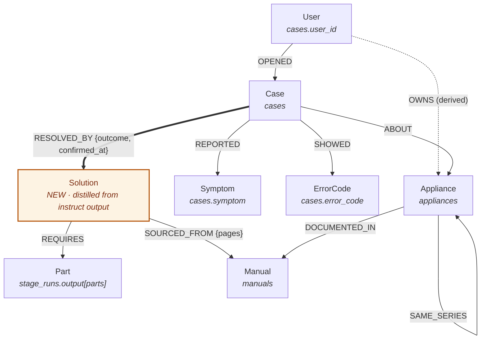

# Proposal: A Repair Knowledge Graph for Opera AI

## The problem

Every case today is an island. We store the case, the photos, and each pipeline
stage's output in Postgres, but nothing connects case 400 to the 39 earlier
cases on the same furnace with the same status code. The diagnose stage
re-derives its answer from the manual every time, at full Gemini Pro cost, and
we never learn whether the repair actually worked.

We also have no memory of the user. `cases.user_id` exists but is never
populated, so a returning customer is a stranger.

## The proposal

Build a knowledge graph in Neo4j that links users, appliances, symptoms, error
codes, and the solutions that resolved them. Postgres stays the source of
truth. The graph is a derived read model that can be rebuilt from Postgres at
any time, so it adds no data-loss risk.

Two things it gives us:

1. **Better and cheaper diagnoses.** Before the diagnose call, look up what
   fixed the same symptom on the same model or its series siblings, and hand
   those as ranked hypotheses to the model. The manual stays the authority;
   the graph changes the order in which hypotheses are checked.
2. **User memory.** "You had an ignition lockout on this furnace in March and
   replacing the flame sensor fixed it." Repeat-issue detection, warranty
   context, and a reason to come back.

## The model

Eight node types, edges named as verbs. Each node's subtitle names where it
comes from in Postgres today. Only `Solution` is new.

`Appliance`, `Case`, and `Manual` mirror tables we already have. `Solution` is
new: a distilled version of the instruct stage's output, deduplicated so the
same fix across many cases is one node with many edges into it. That is what
lets us rank fixes by how often they worked.

| Node | MERGE key | Notes |
|---|---|---|
| User | `user_id` | Column exists, never populated. Needs per-user auth first. |
| Case | `case_id` | Projected when the case reaches `ready`. |
| Appliance | `(brand, model_normalized)` | Same unique constraint as the Postgres table. `SAME_SERIES` comes from the `series` column. |
| Manual | `manual_id` | One node per ingested PDF. |
| Symptom | `text_normalized` | Lowercased and stemmed. Coarse on purpose so cases cluster. |
| ErrorCode | `(brand, code)` | Reuses the regex the retrieval stage already runs. |
| Part | `part_number`, else `(brand, name)` | Only numbers the manual printed. Same rule as today. |
| Solution | vector match above threshold, else new id | Embedded summary in Neo4j's vector index. Inherits `safety_tier` from the gate. |

Each `Solution` inherits the safety verdict from the existing gate, so a
technician-only repair is never surfaced as a DIY suggestion.
